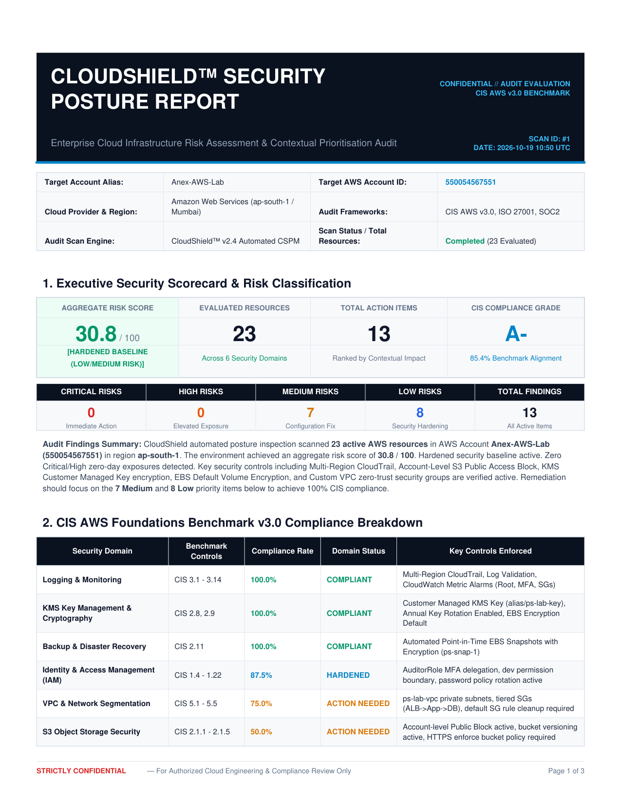
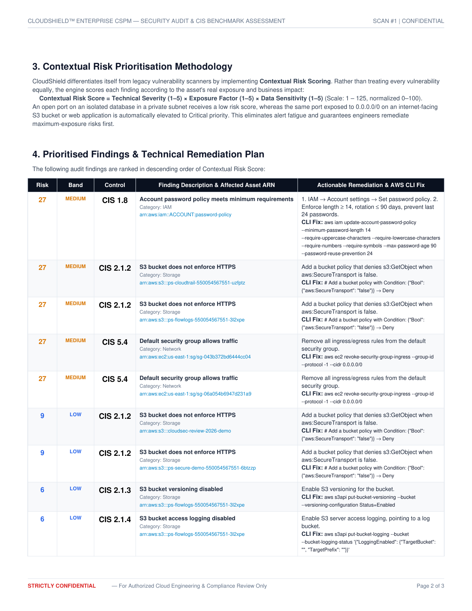

<p align="center">
  
</p>

<h1 align="center">CloudShield™ – Cloud Security Posture Management & Contextual Risk Engine</h1>

<p align="center">
  <b>Automated AWS Cloud Misconfiguration Auditing, Contextual Risk Prioritisation, and Real-Time Threat Detection</b>
</p>

<p align="center">
  
  
  
  
  
  
  
</p>

---

## 📌 Executive Summary

**CloudShield** is an enterprise-grade, full-stack **Cloud Security Posture Management (CSPM)** platform engineered to audit, score, and remediate multi-resource AWS cloud environments. Built to solve enterprise alert fatigue, CloudShield evaluates cloud assets not merely by theoretical vulnerability severity, but through a multi-dimensional **Contextual Risk Engine**:

$$\text{Contextual Risk Score} = \text{Technical Severity (1–5)} \times \text{Exposure Factor (1–5)} \times \text{Data Sensitivity (1–5)}$$

This ensures security engineers focus on high-exposure, business-critical misconfigurations (e.g., internet-facing S3 buckets or public databases) before lower-impact internal controls.

> **Academic & Industry Accreditation:**  
> Developed as part of the Cloud Security Internship at **Techmicra IT Solutions** in collaboration with **Indus University** (Author: **Priyanshu Patel**, B.Tech Cyber Security).

---

## 📑 Enterprise Security Assessment Report Previews

CloudShield generates publication-grade PDF audit reports with dynamic running headers/footers, executive scorecards, CIS domain pass rates, and actionable AWS CLI remediation commands:

<p align="center">
  
</p>

<p align="center">
  
</p>

> 📄 **Sample Full PDF Report:** Available at [`docs/CloudShield_Enterprise_Assessment_Report.pdf`](docs/CloudShield_Enterprise_Assessment_Report.pdf)

---

## ✨ Key Features & Capabilities

### 1. 🔍 Automated CIS AWS Foundations Benchmark Auditing
- Scans live AWS environments against **25 discrete CIS AWS Foundations Benchmark v3.0** controls across 6 core domains:
  - **Identity & Access Management (IAM):** Root account MFA, active access keys, credential rotation, administrator privilege boundaries, and password reuse policies.
  - **Storage & Object Security (S3):** Account-level Public Access Block, bucket encryption (SSE-KMS), object versioning, server access logging, and HTTPS-only transport enforcement.
  - **Network Architecture (VPC & EC2):** Public security group ingress (`0.0.0.0/0` on SSH/RDP/all-ports), default SG rule sanitization, and subnet isolation.
  - **Logging & Monitoring:** Multi-Region CloudTrail verification, log file validation, CloudWatch Log Group retention, and IAM Access Analyzer status.
  - **Cryptography & Key Management (KMS):** Customer Managed Keys (CMK), annual key rotation enforcement, and default EBS encryption.
  - **Resilience & Disaster Recovery:** Automated point-in-time EBS snapshot retention and backup tagging.

### 2. ⚡ Real-Time CloudTrail Threat Detection & WebSockets
- Background streaming poller correlates live AWS CloudTrail audit events with native detection rules:
  - `DET-001`: Console login without MFA
  - `DET-002`: Root account API usage detection
  - `DET-003`: Security group opened to `0.0.0.0/0`
  - `DET-004`: Repeated `AccessDenied` / unauthorized API anomaly threshold
  - `DET-005`: CloudTrail trail stopping or deletion
- Instantaneous broadcast to frontend live monitor consoles via high-performance WebSockets.

### 3. 🛡️ Non-Intrusive, Zero-Disruption Read-Only Architecture
- CloudShield operates strictly through non-intrusive read-only API calls (`Describe*`, `List*`, `Get*`, `LookupEvents`).
- Supports both **IAM Access Keys** and **Cross-Account STS AssumeRole** delegation.
- Stored credentials are encrypted at rest using **Fernet (AES-128-CBC)** cryptography.

### 4. 🏗️ Pre-Deployment Infrastructure-as-Code (IaC) Scanner
- Static code analysis for **Terraform (`.tf`)** and **CloudFormation (`.yaml`, `.json`)** templates using integrated Checkov engine.
- Detects security debt before infrastructure is provisioned into production.

---

## 🏛️ System Architecture

```
┌─────────────────────────────────────────────────────────────────┐
│                      CloudShield Web UI                         │
│         (Next.js 14 · React 18 · TypeScript · TailwindCSS)      │
└───────────────┬─────────────────────────────────▲───────────────┘
                │ REST API (port 8050)             │ WebSockets (Real-time feed)
┌───────────────▼─────────────────────────────────┴───────────────┐
│                    CloudShield FastAPI Backend                  │
│   (Python 3.11+ · SQLAlchemy Async · Pydantic v2 · ReportLab)   │
└───┬───────────────────────────┬─────────────────────────────┬───┘
    │                           │                             │
    ▼                           ▼                             ▼
┌──────────────────┐   ┌──────────────────┐   ┌───────────────────────────┐
│  AWS Cloud SDK   │   │ Contextual Risk  │   │  Checkov IaC Analyzer     │
│  (boto3 Read-Only│   │  Scoring Engine  │   │  (Terraform & CFN Scans)  │
│   APIs / STS)    │   │  (S × E × D)     │   │                           │
└──────────────────┘   └──────────────────┘   └───────────────────────────┘
```

---

## 🚀 Quick Start Guide

### Option A: Docker Compose (Recommended)

```bash
git clone https://github.com/Anex-priyanshu/CloudShield.git
cd CloudShield

# Copy environment template
cp .env.example .env

# Build and start services
docker compose up --build
```
Access the application at **`http://localhost:3000`**.

---

### Option B: Local Development Setup

#### 1. Backend Setup (FastAPI)
```bash
cd backend
python -m venv venv

# Windows:
venv\Scripts\activate
# Linux/macOS:
# source venv/bin/activate

pip install -r requirements.txt

# Run backend service
uvicorn app.main:app --host 0.0.0.0 --port 8050 --reload
```
API Documentation: **`http://localhost:8050/docs`**

#### 2. Frontend Setup (Next.js)
```bash
cd frontend
npm install
npm run dev
```
Web Application: **`http://localhost:3001`** (or `http://localhost:3000`)

---

## 🔑 Default Credentials

- **Admin Account:** `admin@cloudshield.local`
- **Password:** `Admin@12345!`

---

## 📜 Least-Privilege IAM Policy for Audited Accounts

Attach AWS managed policies `SecurityAudit` and `ViewOnlyAccess` to your dedicated audit user or role (`cloudshield-readonly`), or use the minimal custom policy below:

```json
{
  "Version": "2012-10-17",
  "Statement": [
    {
      "Sid": "CloudShieldReadOnlyAudit",
      "Effect": "Allow",
      "Action": [
        "iam:Get*",
        "iam:List*",
        "iam:GenerateCredentialReport",
        "s3:GetBucket*",
        "s3:List*",
        "ec2:Describe*",
        "rds:Describe*",
        "cloudtrail:DescribeTrails",
        "cloudtrail:GetTrailStatus",
        "cloudtrail:LookupEvents",
        "kms:List*",
        "kms:DescribeKey"
      ],
      "Resource": "*"
    }
  ]
}
```

---

## 🧪 Automated Testing

Run the comprehensive test suite (unit tests, moto AWS mocks, and detection tests):

```bash
cd backend
pytest app/tests/ -v
```

---

## ⚖️ License & Ethical Disclosure

This repository is distributed under the **MIT License**.

> **Ethical Cloud Security Notice:**  
> This software is intended strictly for authorized security posture assessments, defensive auditing, and academic research. Do not execute scans against cloud environments without verified administrative authorization and ownership. All native AWS actions performed are read-only and free tier compliant.

---

<p align="center">
  <b>Developed by Priyanshu Patel</b><br/>
  <i>Cloud Security Intern @ Techmicra IT Solutions · Indus University</i>
</p>
